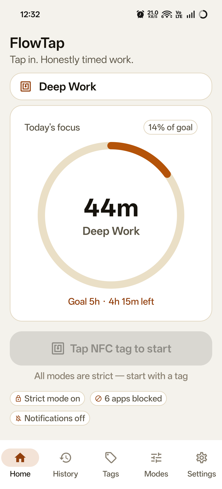
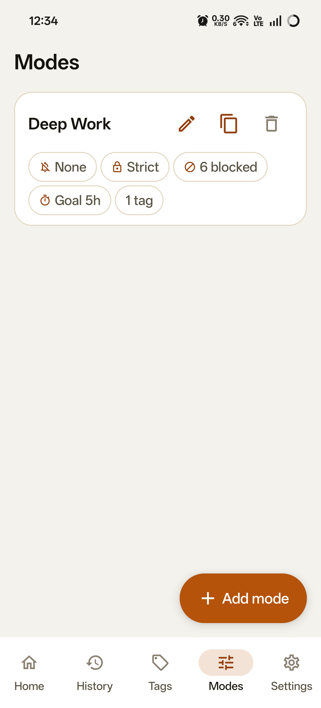
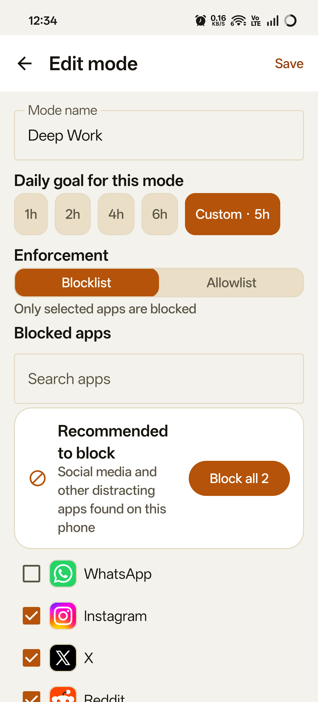
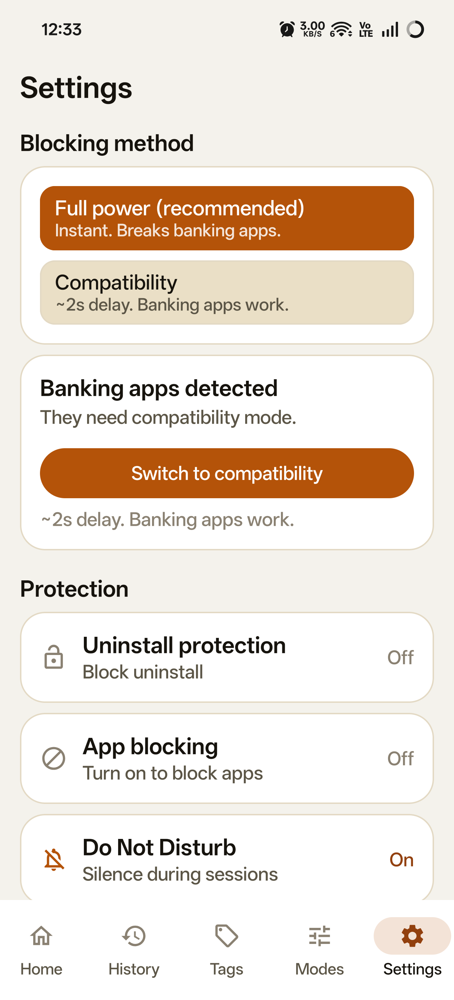

# FlowTap

**An Android focus blocker you start and stop with an NFC tag.**

Put on headphones, tap your phone to a tag on your desk, and the apps you
distracted by get locked out for the length of the session. Tap the tag again
to end it. No timer fiddling, no willpower required — you physically have to
get up to stop it.

| Home | Modes | Mode editor | Settings |
|---|---|---|---|
|  |  |  |  |

---

## Features

- **NFC tag pairing** — start and end sessions by tapping a physical tag.
  Works while the app is closed via an invisible router activity.
- **Modes** — reusable configuration templates: which apps to block, how the
  session ends, sound, duration, goal, and associated tags.
- **Two blocking engines**
  - *Accessibility service* — stronger, blocks on foreground change.
  - *Compatibility mode* — `UsageStats` polling plus an overlay window, for
    devices or setups where the accessibility path is unreliable.
- **Hardcore mode** — locks the blocking method, DND, and hard-lock options at
  the domain layer for the duration of a session, so they can't be quietly
  toggled from Settings.
- **Do Not Disturb and ringer control** — silences the phone for the session.
- **Emergency hold** — always available, even in hardcore mode.
- **Weekly statistics** — session history with correct overlap accounting
  across midnight boundaries.
- **Onboarding** — walks through setup and links straight to the system
  settings pages you need.

## Design contracts

These are the invariants the codebase is built around. They're worth knowing
before you change anything:

- A **mode is configuration**; a **session** is one run of it.
- Edits to a mode apply to the **next** session, never the running one.
- A granted permission is **not** the same thing as blocking being active.
- All completed sessions count, including ones that cross midnight — those are
  split across days rather than dropped.
- An emergency exit always exists.

## Requirements

- Android 8.0 (API 26) or newer
- An NFC-capable device (optional — the app runs fine without it, you just
  start sessions from the UI instead of a tag)

## Build from source

The project uses the Gradle version catalog in `gradle/libs.versions.toml`.
Requires **JDK 17**.

```bash
# point JAVA_HOME at Android Studio's bundled JDK
export JAVA_HOME='/Applications/Android Studio.app/Contents/jbr/Contents/Home'

./gradlew :app:assembleDebug
adb install -r app/build/outputs/apk/debug/app-debug.apk
```

Build on Linux/Windows with your own JDK 17 on `PATH` instead.

## Tests and lint

```bash
./gradlew :app:testDebugUnitTest :app:lintDebug
```

Unit tests cover `SessionPolicy` (strict-tag ending, lock), `BlockingReadiness`
(permission versus enforcement, engine conflict, timer-only), `AppCatalog`
(dedupe, sort, filter) and `StatsCalculator` (midnight overlap splitting, short
session retention, rolling averages), plus legacy stats, time, notification and
poller suites.

See [`TESTING.md`](TESTING.md) for the full QA checklist and current product
contracts.

## Architecture

```
com.flowtap.app
├── session/     SessionManager, SessionService, SessionPolicy, DND + ringer control
├── blocking/    Accessibility engine, compatibility engine, overlay, exemptions
├── nfc/         NdefWriter, tag pairing, NfcRouterActivity
├── data/        Room database, DAOs, DataStore settings, repositories
├── ui/          Jetpack Compose screens — home, modes, editor, tags, history, settings
└── di/          AppContainer
```

Plain Jetpack Compose with manual dependency wiring through `AppContainer` —
no Hilt. Navigation uses Navigation Compose, with route strings collected in a
`Routes` object in `ui/navigation/MainNav.kt`.

## Permissions, and why

An app blocker needs invasive permissions. Here's the full list and its purpose:

| Permission | Why |
|---|---|
| `SYSTEM_ALERT_WINDOW` | Draws the "app blocked" overlay |
| `PACKAGE_USAGE_STATS` | Compatibility engine needs foreground-app data |
| `BIND_ACCESSIBILITY_SERVICE` | Accessibility blocking engine |
| `ACCESS_NOTIFICATION_POLICY` | Toggles Do Not Disturb during a session |
| `MODIFY_AUDIO_SETTINGS` | Silences the ringer |
| `QUERY_ALL_PACKAGES` | Lists installed apps so you can pick what to block |
| `FOREGROUND_SERVICE` + `SPECIAL_USE` | Keeps the session alive while the app is closed |
| `RECEIVE_BOOT_COMPLETED` | Restores session state after a reboot |
| `NFC` | Tag pairing |
| `POST_NOTIFICATIONS` | Session state and warnings |
| `REQUEST_IGNORE_BATTERY_OPTIMIZATIONS` | Stops Android from killing the session service |

FlowTap collects nothing and has no network code. There is no analytics, no
crash reporting, and no internet permission declared in the manifest.

> **Note on banking apps:** compatibility mode may not successfully block every
> banking app, since some render in a separate secure process that ignores
> overlays. The app tells you this explicitly rather than claiming otherwise.

## Contributing

Issues and pull requests are welcome. Please read [`TESTING.md`](TESTING.md)
first — the product contracts there are enforced by tests, and changes that
break them will fail CI-style review.

## License

[MIT](LICENSE) © 2026 Raj Sharma
